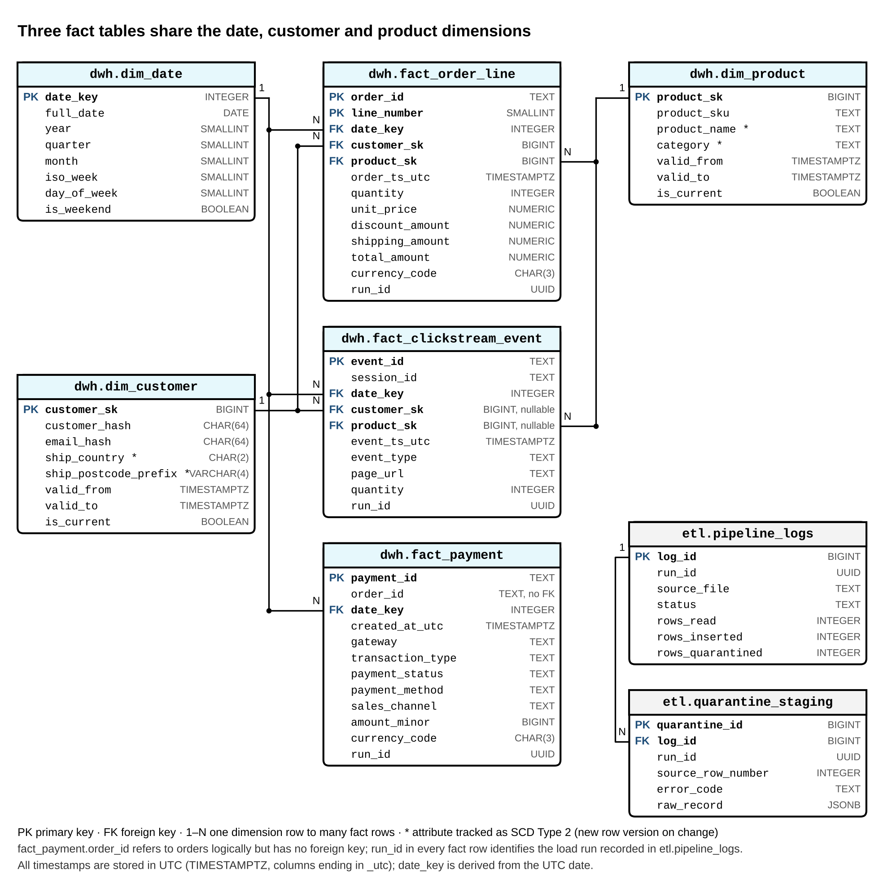

# ecommerce-metadata-driven-etl

Artifact of the Master's thesis *Development and Evaluation of a Configuration-Driven ETL Pipeline for
E-Commerce Data Integration and Analytics* (Kamilla Garifullina, M.Sc. Computer Science,
IU International University of Applied Sciences, 2026).

A generic Python engine, controlled by one declarative YAML file, loads e-commerce order, clickstream and
payment files into a PostgreSQL 16 star schema with SCD Type 2 dimensions. The artifact was developed and
evaluated following the Design Science Research Methodology (Peffers et al., 2007).

## Features

- **Declarative configuration** (`config/pipeline_config.yaml`): source contracts, column types and rules,
  personal-data actions and dimensions; the engine contains no source-specific code.
- **Row-level quarantine**: defective records go to `etl.quarantine_staging` with an error code;
  the rest of the file is loaded.
- **Reconciliation**: every file satisfies rows read = rows inserted + rows quarantined, checked in Python
  and by a database constraint.
- **Pseudonymization**: customer identifiers and e-mail addresses are replaced by keyed HMAC-SHA-256 hashes
  before anything is written; names are dropped and postcodes truncated. The output is pseudonymized, not
  anonymized, personal data.
- **Audit log**: one entry per file and run in `etl.pipeline_logs`, with status, duration and row counts.
- **UTC everywhere in the warehouse**: timestamps without an offset are interpreted in the configured
  time zone (`defaults.timezone`, Europe/Berlin) and converted to UTC; all warehouse timestamps are
  `TIMESTAMPTZ` columns ending in `_utc`, and `date_key` is derived from the UTC date.

## Repository structure

| Path | Content |
| --- | --- |
| `src/` | Sample input data: orders, clickstream and payment CSV files, plus the injection log (see `src/README.md`) |
| `config/pipeline_config.yaml` | Pipeline configuration |
| `scripts/etl_engine.py` | ETL engine |
| `scripts/schema.sql` | Warehouse DDL (schemas `etl` and `dwh`) and the `dim_date` load |
| `scripts/create_database.sql` | One-time creation of the warehouse database and its user |
| `scripts/test_harness.py` | End-to-end verification (two scenarios, 18 checks) |
| `docs/star_schema.png` | Star schema: fact and dimension tables and how they link |
| `chapter5_reproducibility/` | Data generator, benchmark and evaluation scripts, reference results (see its README) |
| `figures/` | Data and script for Figures 6–9 of the thesis |

## Data model



Three fact tables share the conformed dimensions:

| Fact table (grain) | `dim_date` | `dim_customer` | `dim_product` |
| --- | --- | --- | --- |
| `fact_order_line` (one order line) | `date_key` | `customer_sk` | `product_sk` |
| `fact_clickstream_event` (one event) | `date_key` | `customer_sk` (NULL = anonymous) | `product_sk` (NULL = no product) |
| `fact_payment` (one payment transaction) | `date_key` | – | – |

`dim_customer` and `dim_product` are SCD Type 2 dimensions: a change in a tracked attribute closes the
current row (`valid_to`, `is_current = false`) and inserts a new version, and each fact row points to the
version valid at its event time. `fact_payment.order_id` refers to orders logically but has no foreign
key. Every fact row carries the `run_id` of the load recorded in `etl.pipeline_logs`.

## Requirements

- Python 3.12 or later
- `pip install pandas pyyaml psycopg2-binary` (add `matplotlib` to regenerate the figures)
- PostgreSQL 16, for example in Docker:

```bash
docker run --name iu-thesis-postgres -e POSTGRES_PASSWORD=<password> -p 5433:5432 -d postgres:16
```

Use `port=5432` in the connection strings below if PostgreSQL is installed locally rather than in this
Docker container.

## Running the verification

From the repository root:

```bash
python scripts/test_harness.py \
  --admin-dsn "host=localhost port=5433 user=postgres dbname=postgres password=<password>"
```

The harness creates its own temporary database `etl_harness` from `scripts/schema.sql`, sets a test salt
for pseudonymization and runs the unmodified engine (`scripts/etl_engine.py`, `config/pipeline_config.yaml`)
as a subprocess. Add `--drop-db` to remove the test database afterwards. Expected result:
`RESULT: 18 of 18 checks passed`.

## Running the pipeline on the sample data

1. Create the warehouse database and user once (see the comments in the file):

   ```bash
   psql "host=localhost port=5433 user=postgres dbname=postgres" -f scripts/create_database.sql
   psql "host=localhost port=5433 dbname=shop user=etl password=change_me" -f scripts/schema.sql
   ```

   Without a local `psql` client (for example on Windows with Git Bash), run the same files inside the
   Docker container:

   ```bash
   docker exec -i iu-thesis-postgres psql -U postgres -d postgres < scripts/create_database.sql
   docker exec -i iu-thesis-postgres psql -U etl -d shop < scripts/schema.sql
   ```

2. Set the two environment variables the engine reads. `ETL_PG_DSN` is the *name of an environment
   variable* that holds the connection string (`pipeline.database.dsn_env` in the configuration); it is
   not a database name:

   ```bash
   export ETL_PG_DSN="host=localhost port=5433 dbname=shop user=etl password=change_me"
   export ETL_PII_SALT="<a long random secret>"
   ```

3. Copy the sample files into the inbox and run the engine:

   ```bash
   mkdir -p data/inbox data/archive
   cp src/orders_*.csv src/clickstream_*.csv src/payments_page_*.csv data/inbox/
   python scripts/etl_engine.py --config config/pipeline_config.yaml
   ```

Processed files are moved to `data/archive/`. Rejected rows are in `etl.quarantine_staging`, and every
file has one entry in `etl.pipeline_logs`.

## Reproducing Chapter 5

See `chapter5_reproducibility/README.md` for the benchmark (four volume tiers, five repetitions each),
the change-effort scenarios S1–S4 and the analytical queries Q1–Q4. The folder contains its own copy of
the evaluated artifact in `chapter5_reproducibility/pipeline/`, identical to Appendices B–D of the thesis.

## Reproducing Figures 6–9

The CSV files in `figures/data/` contain the measured values reported in Tables 16, 17, 20 and 21 of the
thesis. To regenerate the figures:

```bash
cd figures
python make_figures.py
```
